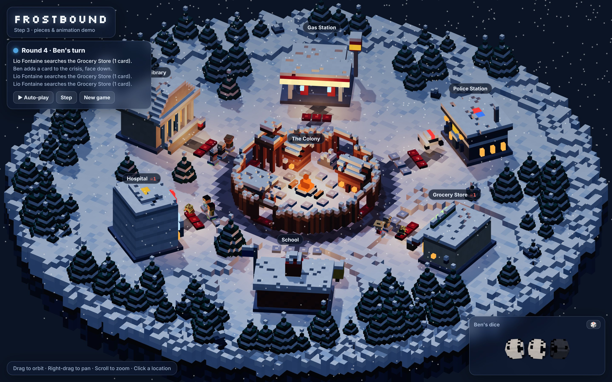
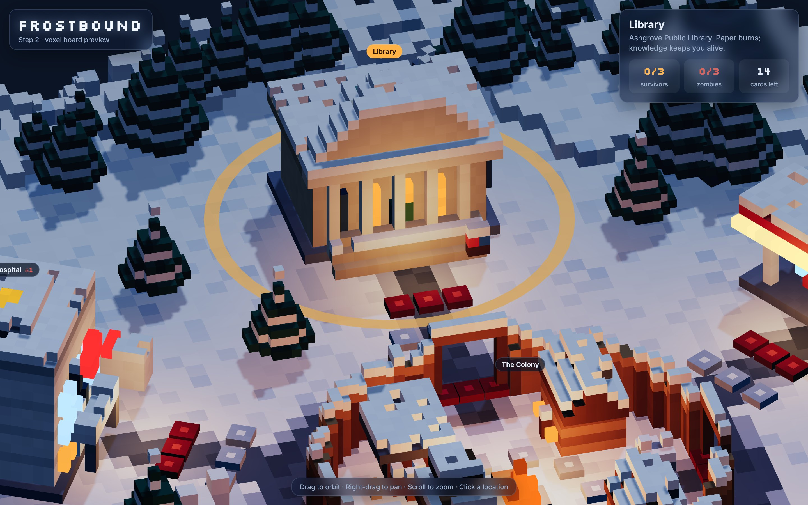
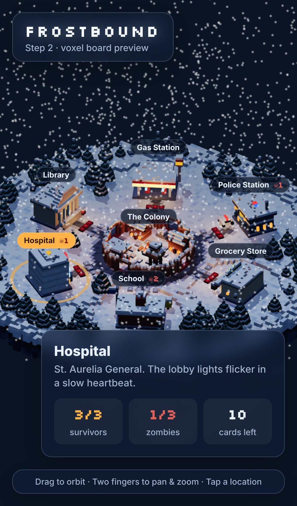

# FROSTBOUND

An original, semi-cooperative survival board game set in a frozen zombie apocalypse, built for the browser with a 3D voxel look (Three.js).
2–5 players play hot-seat, with optional bots for empty seats.

> **Status: steps 1–3 of 6 are done.** The rules engine, the voxel board, and animated voxel survivors, zombies and dice are in place. The demo page plays a real game with bots so you can watch everything move. The playable UI comes in step 4.



| All 20 survivors + zombies | Around the campfire | Colony phase: zombies rise, barricades break |
|---|---|---|
|  |  |  |

| Location panel | Phone |
|---|---|
|  |  |

## Running

```bash
npm install
npm run dev           # http://localhost:5173: bots auto-play; drag to orbit, right-drag to pan, scroll to zoom, click a location
npm test              # rules + render-helper tests, including ~130 full bot games checked after every action
npm run build         # static bundle in dist/
npm run balance       # bot-vs-bot outcome table per scenario and player count
```

Use Node 20 or later. URL options:
- framing: `?focus=colony&zoom=2.5&azimuth=-30&select=police&snow=0`
- demo: `?autoplay=0` (start paused), `?advance=40` (skip ahead N bot actions), `?seed=3`, `?scenario=beacon`
- `?lineup`: every survivor and zombie variant side by side

## Architecture

```
src/
  core/                 PURE rules engine: no DOM, no Three.js, JSON-serializable state
    constants.js        phases, item types, exposure die faces, tunables
    rng.js              seeded mulberry32; its seed lives in state.rng, so games replay deterministically
    state.js            createGame(config) -> GameState
    actions.js          action types + creators ({ type, playerId, ... })
    reducer.js          reduce(state, action) -> new state (never mutates); tryReduce() -> { ok, state, error }
    selectors.js        derived read-only queries for UI and renderer (foodNeeded, pendingActors, ...)
    view.js             viewFor(state, playerId): redacts hidden info for hot-seat and network clients
    errors.js           RuleError with a stable `code` (an i18n key)
    rules/
      flow.js           draft -> round start -> turns -> colony phase -> end of game
      turn.js           die actions + free actions of the active player
      social.js         crossroads choices, item requests, exile votes
      effects.js        data-driven effect interpreter (crossroads choices, crisis failures)
      conditions.js     predicate language (crossroads triggers, secret objectives)
      helpers.js        wounds/death/exposure, zombies/overrun, dice, logging
  content/              all original cards and characters, as pure data
  ai/simpleBot.js       botAction(state, playerId) -> action
  ai/simulate.js        headless bot-vs-bot driver (tests + balance)
  render/               Three.js only; reads state, never changes it
    voxel.js            VoxelModel: sparse voxel grid -> ONE merged, face-culled BufferGeometry (+ a separate glow mesh)
    palette.js          art-direction colours (cold night / warm light / muted danger)
    buildings.js        voxel designs: colony, 6 locations, pine, rock
    board.js            plateau terrain, roads, layout + slot anchors, instanced trees/slots, pick targets, warm lights
    stage.js            renderer, orthographic orbit camera with limits, moonlight + shadows, exp fog, snowfall
    characters.js       20 survivor looks (hats, gear, build), 3 hunched zombie variants, d6 die, barricade
    pieces.js           PieceManager: diffs GameState -> hop / pop-in / topple survivors; zombies rise, shuffle and sink;
                        barricades; snow-puff particles (zombies + barricades + puffs are instanced)
    dice.js             dice tray on its own small canvas; dice tumble and settle on the rolled face; used dice dim
    tween.js            frame-driven tween engine + easings
  ui/style.css          frosted-glass overlay
  ui/logText.js         temporary English event text for the demo ticker
  main.js               boots stage/board/pieces/dice; bots play a seeded demo game with Auto-play / Step / New game
index.html
tests/                  node:test suites (rules + headless render helpers)
```

Later steps add `src/ui/` panels and `src/i18n/` (EN/TH).

### Rendering notes
- **Models:** every model is built from voxels in code; there are no asset files. Each building merges into one mesh with hidden faces culled. Glowing voxels (windows, fire, signs) go into an unlit mesh that ignores fog.
- **Instancing:** trees, rocks and slot markers are `InstancedMesh`es. The whole board renders in about 29 draw calls and about 105k triangles.
- **Layout data:** `computeLayout()` gives each location its centre, facing, label anchor, and world positions for every survivor and zombie slot.
- **State-driven animation:** the renderer never decides what happens. `pieces.sync(state)` compares the new state with what's on screen and animates the difference:
  - Survivors keep their slot when possible and hop along a route through the nearest colony gate.
  - Zombies fill colony gates round-robin, and barricades fill slots from the far end so the two never overlap.
  - `pieces.busy` tells the game loop when it's safe to show the next action.
The UI only *reads* state through selectors and `viewFor`, and only *changes* it by dispatching actions to `reduce`.
Because of that, networking or saving to localStorage only needs `serialize`/`deserialize` plus the action stream.

### Hidden information
- `viewFor(state, seat)` strips other players' hands and objectives, the identity of face-down crisis cards, deck order, the RNG seed, and any card-id lookups the seat shouldn't have. Everything is revealed at game over.
- Log entries for crisis contributions record *who* contributed, never *what*.

## Rules as implemented

**Setup.** Pick a scenario and 2–5 players. Each player is dealt a secret objective.
- In `betrayer: 'maybe'` mode (the default), `n` loyal cards and 1 betrayer card are shuffled together and `n` are dealt, so a betrayer may or may not be in the game.
- `'always'` and `'never'` modes are also available.

Each player is offered 4 survivors and keeps 2; unpicked survivors return to the survivor deck. Survivors start in the colony, and each player draws 3 starting items. The player controlling the highest-influence survivor goes first.

**Round.**
1. Reveal a crisis.
2. Every player rolls `1 + survivors` d6. (The Bike Courier's ability adds 1 more.)
3. Turns go around the table. Before each turn, the next player draws a crossroads card. If its trigger holds for the active player, everyone sees it and the active player picks one of its two choices; otherwise it is discarded unseen.

**Die actions** (each uses one unused die):

| Action | Requirement | Effect |
|---|---|---|
| Attack | die ≥ attack value; zombies present | kill 1 zombie, then roll exposure |
| Search | die ≥ search value; not in the colony | draw 1 card from the location deck |
| Barricade | any die; a free zombie slot | +1 barricade (barricades share the zombie slots) |
| Clean | any die; in the colony | remove 3 waste |
| Lure | any die; zombies present | move 1 zombie from here to any other location |

**Free actions:**
- Move each survivor once per turn. Moving rolls exposure unless you discard a fuel card. You can't enter a full location, and exiled players can't enter the colony.
- Play a card:
  - food → colony supply
  - medicine → heal 1 wound or frostbite
  - tools → +1 barricade
  - weapon → kill a zombie without rolling exposure
  - junk → reroll one of your unused dice
- Contribute a card to the crisis, face down.
- Deposit a card for the scenario goal.
- Request an item from another player; they may give it or decline.
- Use the Surgeon's heal.
- Call an exile vote (once per round).

**Exposure die (12 faces).**

| Face | Count | Effect |
|---|---|---|
| blank | 6 | nothing |
| wound | 3 | +1 wound |
| frostbite | 2 | +1 wound now, and +1 more each colony phase spent outside; the campfire cures it |
| bite | 1 | the survivor dies, and the lowest-influence survivor at the same location must roll exposure (this can chain) |

A survivor dies at 3 wounds. Every death costs 1 morale. A player who loses everyone recruits a replacement.

**Zombies.** An arriving zombie first destroys a barricade if there is one. If the entrance is full, it overruns instead and kills the lowest-influence survivor there. At the colony, helpless survivors die first.

**Colony phase** (resolved in this order):
1. **Food:** pay 1 per 2 colony residents, including helpless survivors. If you can't pay, gain a starvation token and lose morale equal to your tokens. A full meal removes one token.
2. **Waste:** lose 1 morale per 10 waste.
3. **Crisis:** shuffle and reveal the contributions. Each matching card counts +1 and every other card counts −1 (that's how sabotage works). The requirement is `ceil(players / 2)`. Beating it by 2 or more gives +1 morale; failing applies the crisis penalty.
4. **Spawn:** each occupied outside location gets `ceil(survivors / 2)` zombies, and the colony gets `ceil(residents / 3)`.
5. **Frostbite** worsens outside the colony.
6. **Checks:** morale 0 means the colony falls. Otherwise check the scenario goal, then advance the round tracker; if it runs out, the colony falls.

**Winning.**
- If the main objective is completed, every non-betrayer whose secret (or exile) objective is also met wins. Several players can win.
- If the colony falls, only a betrayer whose condition is met wins.

**Exile vote.** Any player can call a vote during a turn. It needs a strict majority of the *other* players. An exiled loyal player swaps their objective for a random exile objective; a betrayer keeps theirs. An exiled player's survivors leave the colony and can never return. Exiled players can't contribute to crises, deposit, or add food.

## Content (all original)
- 20 survivors, each with a unique ability: `src/content/survivors.js`
- 10 secret objectives (8 loyal, 2 betrayer) and 3 exile objectives: `objectives.js`
- 3 scenarios:

  | Scenario | Rounds | Starting morale | Difficulty |
  |---|---|---|---|
  | Light the Ridge Beacon | 5 | 8 | easy |
  | Fill the Root Cellar | 7 | 7 | medium |
  | Clear the Drift | 9 | 6 | hard |

- 10 crises: `crises.js`
- 30 crossroads cards, each with a trigger and two choices: `crossroads.js`
- 37 item cards of 6 types, spread across 6 location decks (15–16 cards each): `items.js`, `locations.js`

## Known open items
- **Balance:** the simple bot still loses most games. It sends everyone out scavenging and rarely deposits, so the bot win rate says more about the bot than the game. Tune these numbers in human playtests: crisis requirement, spawn rates, starting morale.
- The bot is intentionally simple. A smarter seat AI comes with the UI work.
