# FROSTBOUND

An original, semi-cooperative survival board game set in a frozen zombie apocalypse, built for the browser with a 3D voxel look (Three.js).
2–5 players play hot-seat, with optional bots for empty seats.

> **Status: all 8 build steps are done.** The game is fully playable in the browser: hot-seat for 2–5 players, with AI for any seat, in English or Thai. It has animated crossroads, crisis, exposure and exile-vote reveals, procedural sound, ambient particles and a guided first-round tutorial. Step 7 adds an HD graphics overhaul with Low / Medium / High quality tiers. Step 8 adds generated portraits and item art, a more visual UI, and a UI bug-fix pass.

| Step 8: before / after (turn, hand) | |
|---|---|
| 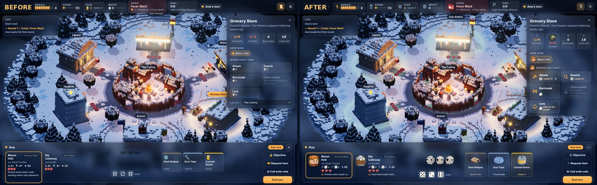 | 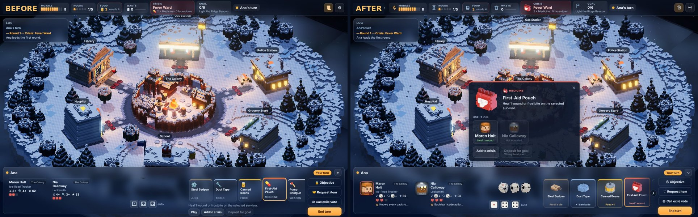 |

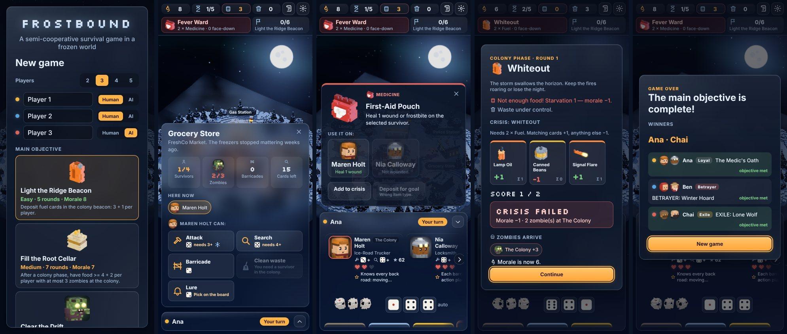

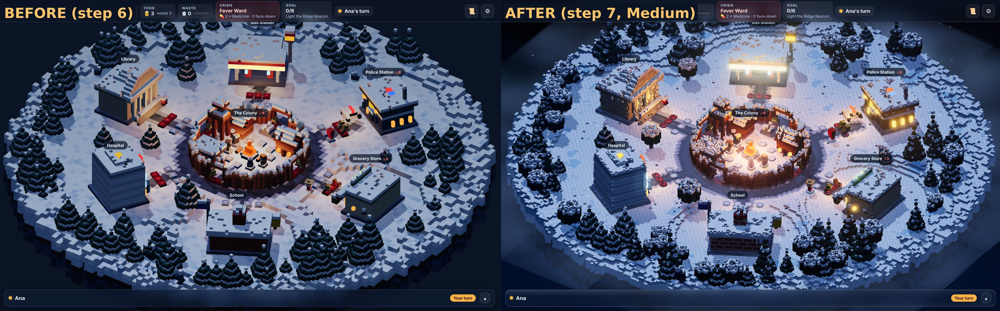

| Colony | Police Station | Characters |
|---|---|---|
| 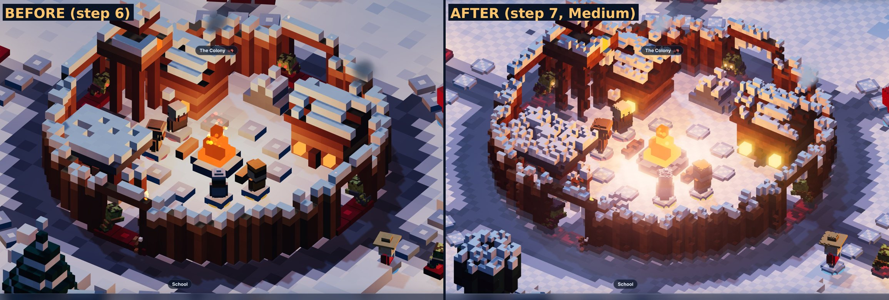 | 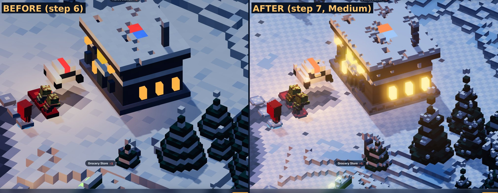 | 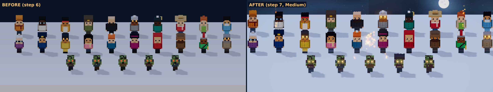 |

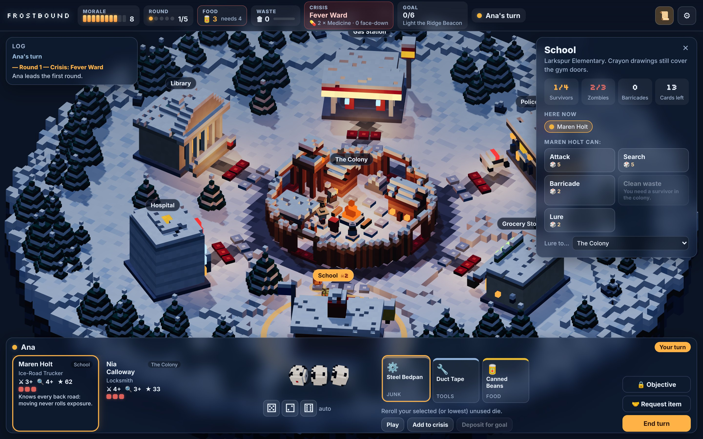

| Setup | ภาษาไทย | Crossroads (card flip, TH) |
|---|---|---|
| 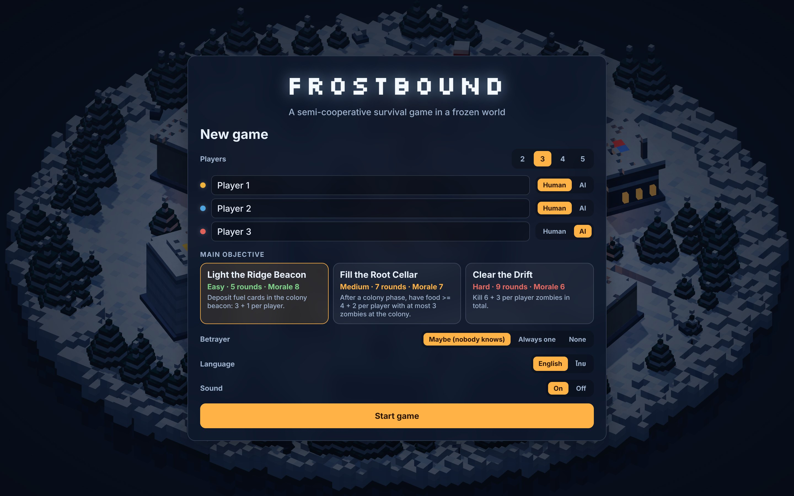 | 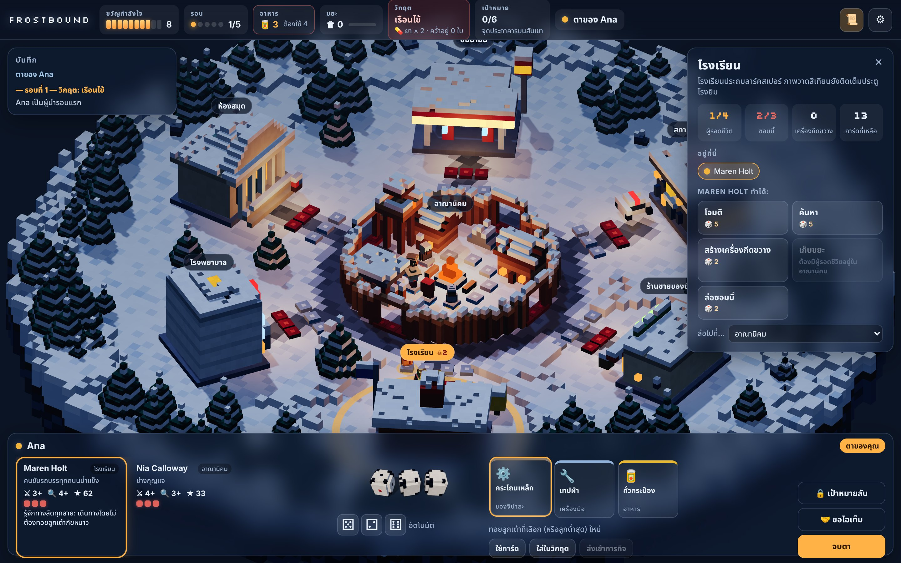 | 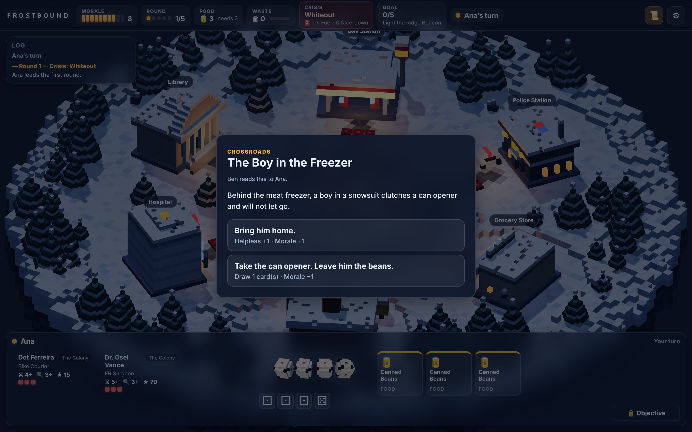 |

| Colony phase: crisis cards revealed one by one | Exile vote result | Exposure die + floating result |
|---|---|---|
| 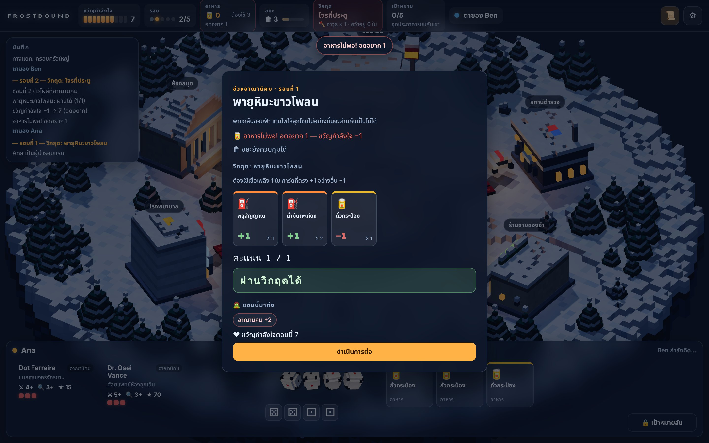 | 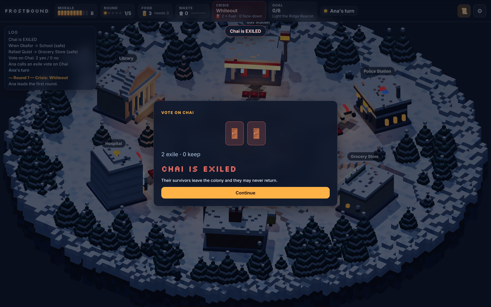 | 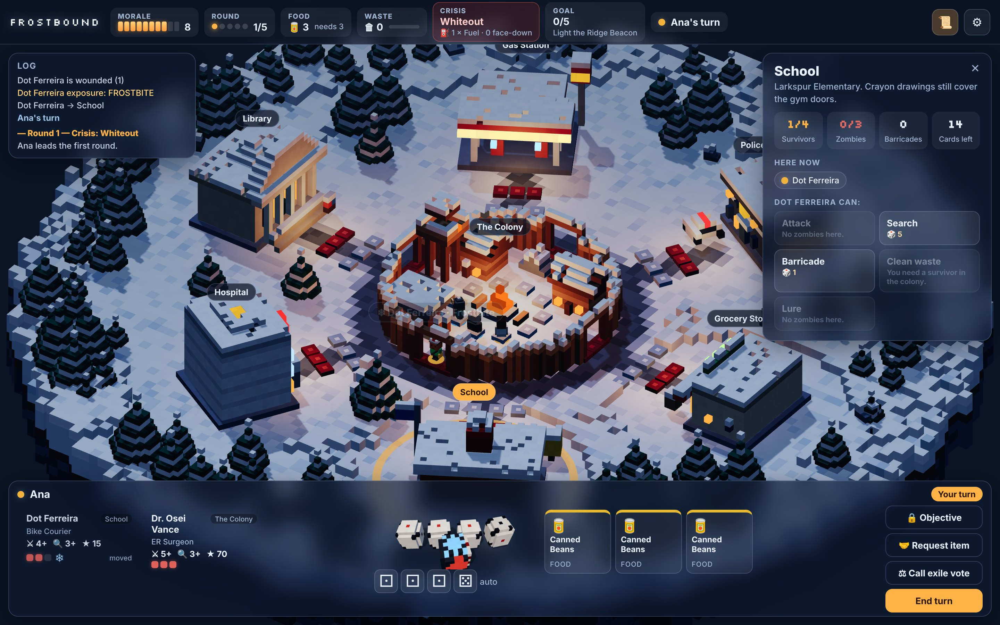 |

| First-round tutorial (TH) | Campfire embers, chimney smoke, torch sparks |
|---|---|
| 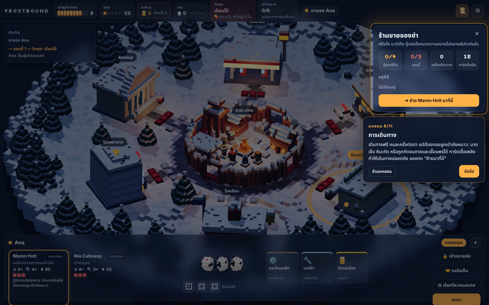 | 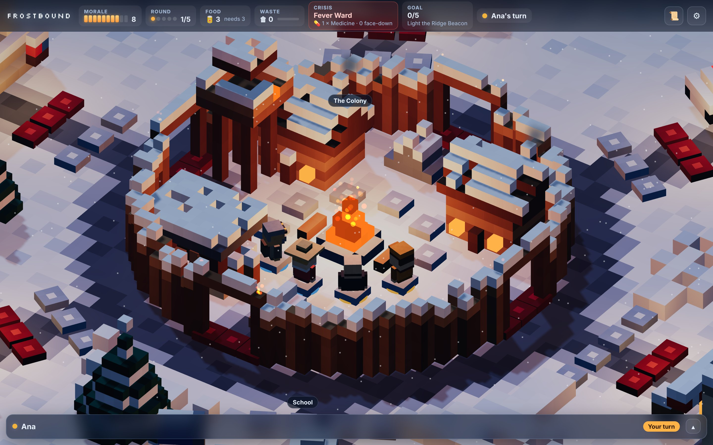 |

| All 20 survivors + zombies | Around the campfire | Colony phase |
|---|---|---|
| 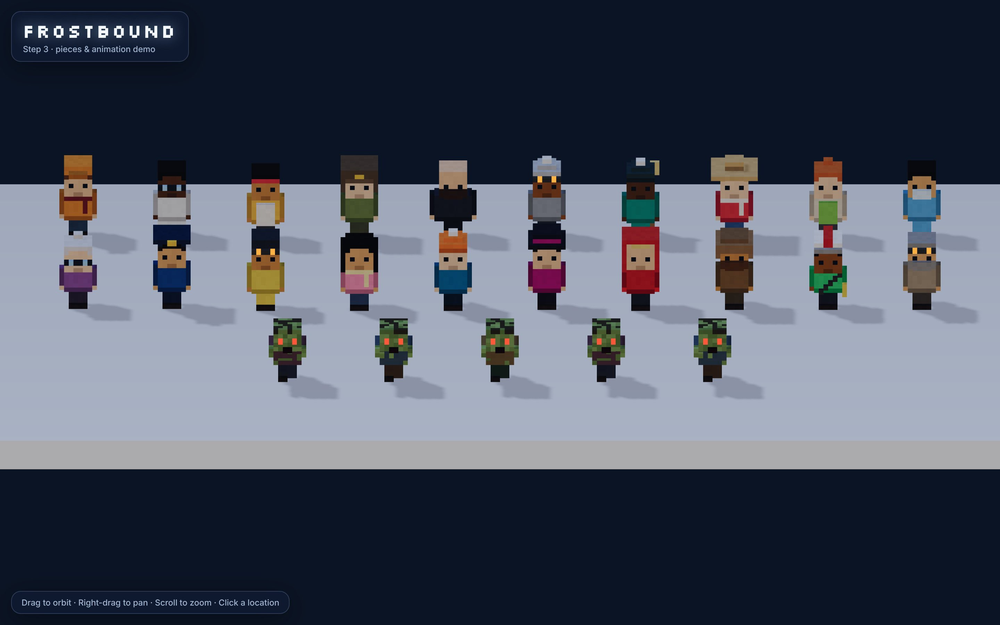 | 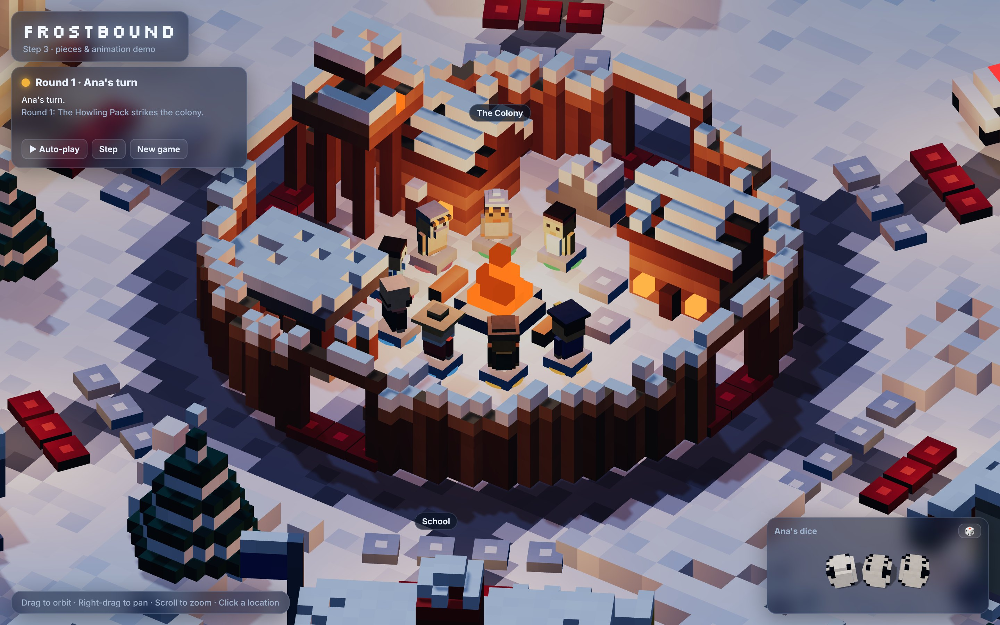 | 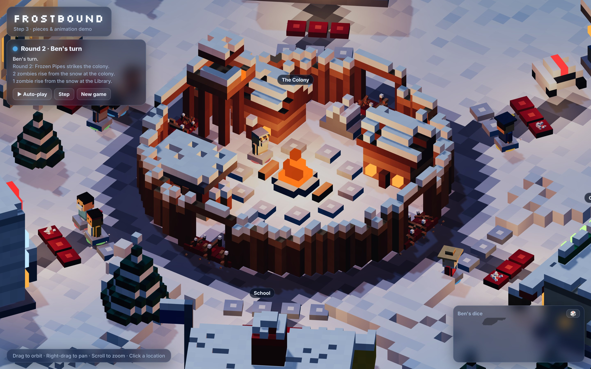 |

## How to play (UI)
1. **Setup:** choose 2–5 seats (Human or AI), a main objective, the betrayer mode, the language, sound, and the **first-round tutorial**. The tutorial is on until you finish it once. It spotlights each part of the screen and moves on when you actually do the thing it asks.
2. **Draft:** each human gets a *Pass to …* screen, then picks 2 of 4 survivors.
3. **On your turn:**
   - Select a survivor: click its card or the figure on the board.
   - Click a location to see what's there.
   - From the panel, **Move here** (tick *Use fuel* to skip the exposure roll), or use **Attack / Search / Barricade / Clean / Lure** for a survivor already there.
   - Each action uses the cheapest die that works; click a die chip to force a specific one.
4. **Cards:** click a card in your hand to **Play** it, **Add to crisis** (face down), or **Deposit for goal**.
5. **Other controls:**
   - **🔒 Objective:** press and hold to peek at your secret objective.
   - **🤝 Request item:** ask another player for a card.
   - **⚖ Call exile vote:** once per round. Every other player votes in secret (each human behind their own pass screen), then the ballots are revealed.
   - **End turn:** pass to the next player.
6. **Crossroads:** before your turn a card may flip up, showing *why* it triggered and both choices with their exact effects.
7. **Colony phase:** after every round a public reveal walks through:
   - food (or starvation)
   - waste
   - each face-down crisis card flipped one at a time, with a running score (+1 matching, −1 sabotage)
   - the verdict
   - the zombies that arrive
8. **Exposure:** moving or attacking throws the voxel exposure die in the dice tray, and the result floats over the survivor on the board.
9. **Hot seat:** between human players a full-screen *Pass to …* screen hides every hand and objective until the next player taps it.
10. **Phones:** the ▾ button collapses the player panel so the board gets the screen back.
11. **Saving:** the game autosaves after every action, and *Continue saved game* resumes it.

## Running

```bash
npm install
npm run dev           # http://localhost:5173: drag to orbit, right-drag to pan, scroll to zoom
npm test              # rules + render-helper tests, including ~130 full bot games checked after every action
npm run build         # static bundle in dist/
npm run balance       # bot-vs-bot outcome table per scenario and player count
```

Use Node 20 or later. URL options:
- framing: `?focus=colony&zoom=2.5&azimuth=-30&select=police&snow=0`
- quick start without the setup screen: `?play=HHA&scenario=beacon&seed=3&lang=th` (H = human seat, A = AI seat)
- `?ai=fast`: AI seats don't wait for animations (testing on slow machines)

## Architecture

```
src/
  core/                 PURE rules engine: no DOM, no Three.js, JSON-serializable state
    constants.js        phases, item types, exposure die faces, tunables
    rng.js              seeded mulberry32; its seed lives in state.rng, so games replay deterministically
    state.js            createGame(config) -> GameState
    actions.js          action types + creators ({ type, playerId, ... })
    reducer.js          reduce(state, action) -> new state (never mutates); tryReduce() -> { ok, state, error }
    selectors.js        derived read-only queries for UI and renderer (foodNeeded, pendingActors, ...)
    view.js             viewFor(state, playerId): redacts hidden info for hot-seat and network clients
    errors.js           RuleError with a stable `code` (an i18n key)
    rules/
      flow.js           draft -> round start -> turns -> colony phase -> end of game
      turn.js           die actions + free actions of the active player
      social.js         crossroads choices, item requests, exile votes
      effects.js        data-driven effect interpreter (crossroads choices, crisis failures)
      conditions.js     predicate language (crossroads triggers, secret objectives)
      helpers.js        wounds/death/exposure, zombies/overrun, dice, logging
  content/              all original cards and characters, as pure data
  ai/simpleBot.js       botAction(state, playerId) -> action
  ai/simulate.js        headless bot-vs-bot driver (tests + balance)
  render/               Three.js only; reads state, never changes it
    voxel.js            VoxelModel: sparse voxel grid -> ONE merged, face-culled BufferGeometry (+ a separate glow mesh)
    palette.js          art-direction colours (cold night / warm light / muted danger)
    buildings.js        voxel designs: colony, 6 locations, pine, rock
    board.js            plateau terrain, roads, layout + slot anchors, instanced trees/slots, pick targets, warm lights
    stage.js            renderer, orthographic orbit camera with limits, moonlight + shadows, exp fog, snowfall
    characters.js       20 survivor looks (hats, gear, build), 3 hunched zombie variants, d6 die, barricade
    pieces.js           PieceManager: diffs GameState -> hop / pop-in / topple survivors; zombies rise, shuffle and sink;
                        barricades; snow-puff particles (zombies + barricades + puffs are instanced)
    dice.js             dice tray on its own small canvas; dice tumble and settle on the rolled face; used dice dim;
                        the exposure die (wound / frostbite / bite symbols) is thrown here too
    tween.js            frame-driven tween engine + easings
    detail.js           HD detail passes: materials/patterns, dithering, frames + sills, icicles, lumpy snow
    terrain.js          HD heightmap terrain mesher (top faces with AO + merged side walls)
    quality.js          Low / Medium / High tiers and how the active one is chosen
    art.js              portrait + item art studio (CPU voxel painter, lazy cache)
    items3d.js          voxel models for all 36 item cards
    particles.js        campfire embers, chimney smoke, gate-torch sparks (per-particle size/colour/alpha shader)
  i18n/                 en.js + th.js UI strings, content.th.js (Thai content), format.js (log lines, effect text)
  ui/
    app.js              controller: dispatch -> reducer, AI seats, hot-seat pass screens, autosave, settings, toasts
    options.js          pure: which actions are legal right now (asks the engine via tryReduce), die picking,
                        card targets, lure/move targets, acting survivors, end-turn confirmation
    seat.js             pure: who must hold the device (incl. answering an item request)
    icons.js            SVG icons, drawn die faces, hearts
    tooltip.js          shared tooltip for hover / focus / touch
    views/hud.js        top bar (morale, round, food, waste, crisis, goal, turn) + log panel
    views/player.js     survivors, dice chips, hand + card actions, hold-to-peek objective, request, end turn
    views/location.js   location details, who is here, move / die actions for the selected survivor
    views/modals.js     setup, settings, pass screen, draft, crossroads (flip), colony-phase reveal,
                        call vote / secret ballot / vote result, requests, game over
    style.css           frosted-glass overlay, responsive down to phone width
  audio/sound.js        procedural WebAudio: a sound per game event (dice, hops, hits, groans, card flips, chords),
                        ambient wind + campfire crackle; unlocks on first click; safe no-op without audio
  ui/tutorial.js        pure first-round tutorial state machine (steps, events, visibility)
  ui/views/tutorial.js  spotlight + coach bubble that follow the highlighted element
  main.js               boots stage/board/pieces/dice, board picking, labels, and the UI controller
index.html
tests/                  node:test suites (rules + headless render helpers)
```

Later steps add `src/ui/` panels and `src/i18n/` (EN/TH).

### Rendering notes
- **Models:** every model is built from voxels in code; there are no asset files. Each building merges into one mesh with hidden faces culled. Glowing voxels (windows, fire, signs) go into an unlit mesh that ignores fog.
- **Instancing:** trees, rocks and slot markers are `InstancedMesh`es. The whole board renders in about 29 draw calls and about 105k triangles.
- **Layout data:** `computeLayout()` gives each location its centre, facing, label anchor, and world positions for every survivor and zombie slot.
- **State-driven animation:** the renderer never decides what happens. `pieces.sync(state)` compares the new state with what's on screen and animates the difference:
  - Survivors keep their slot when possible and hop along a route through the nearest colony gate.
  - Zombies fill colony gates round-robin, and barricades fill slots from the far end so the two never overlap.
  - `pieces.busy` tells the game loop when it's safe to show the next action.
The UI only *reads* state through selectors and `viewFor`, and only *changes* it by dispatching actions to `reduce`.
Because of that, networking or saving to localStorage only needs `serialize`/`deserialize` plus the action stream.

### Hidden information
- `viewFor(state, seat)` strips other players' hands and objectives, the identity of face-down crisis cards, deck order, the RNG seed, and any card-id lookups the seat shouldn't have. Everything is revealed at game over.
- Log entries for crisis contributions record *who* contributed, never *what*.

## Rules as implemented

**Setup.** Pick a scenario and 2–5 players. Each player is dealt a secret objective.
- In `betrayer: 'maybe'` mode (the default), `n` loyal cards and 1 betrayer card are shuffled together and `n` are dealt, so a betrayer may or may not be in the game.
- `'always'` and `'never'` modes are also available.

Each player is offered 4 survivors and keeps 2; unpicked survivors return to the survivor deck. Survivors start in the colony, and each player draws 3 starting items. The player controlling the highest-influence survivor goes first.

**Round.**
1. Reveal a crisis.
2. Every player rolls `1 + survivors` d6. (The Bike Courier's ability adds 1 more.)
3. Turns go around the table. Before each turn, the next player draws a crossroads card. If its trigger holds for the active player, everyone sees it and the active player picks one of its two choices; otherwise it is discarded unseen.

**Die actions** (each uses one unused die):

| Action | Requirement | Effect |
|---|---|---|
| Attack | die ≥ attack value; zombies present | kill 1 zombie, then roll exposure |
| Search | die ≥ search value; not in the colony | draw 1 card from the location deck |
| Barricade | any die; a free zombie slot | +1 barricade (barricades share the zombie slots) |
| Clean | any die; in the colony | remove 3 waste |
| Lure | any die; zombies present | move 1 zombie from here to any other location |

**Free actions:**
- Move each survivor once per turn. Moving rolls exposure unless you discard a fuel card. You can't enter a full location, and exiled players can't enter the colony.
- Play a card:
  - food → colony supply
  - medicine → heal 1 wound or frostbite
  - tools → +1 barricade
  - weapon → kill a zombie without rolling exposure
  - junk → reroll one of your unused dice
- Contribute a card to the crisis, face down.
- Deposit a card for the scenario goal.
- Request an item from another player; they may give it or decline.
- Use the Surgeon's heal.
- Call an exile vote (once per round).

**Exposure die (12 faces).**

| Face | Count | Effect |
|---|---|---|
| blank | 6 | nothing |
| wound | 3 | +1 wound |
| frostbite | 2 | +1 wound now, and +1 more each colony phase spent outside; the campfire cures it |
| bite | 1 | the survivor dies, and the lowest-influence survivor at the same location must roll exposure (this can chain) |

A survivor dies at 3 wounds. Every death costs 1 morale. A player who loses everyone recruits a replacement.

**Zombies.** An arriving zombie first destroys a barricade if there is one. If the entrance is full, it overruns instead and kills the lowest-influence survivor there. At the colony, helpless survivors die first.

**Colony phase** (resolved in this order):
1. **Food:** pay 1 per 2 colony residents, including helpless survivors. If you can't pay, gain a starvation token and lose morale equal to your tokens. A full meal removes one token.
2. **Waste:** lose 1 morale per 10 waste.
3. **Crisis:** shuffle and reveal the contributions. Each matching card counts +1 and every other card counts −1 (that's how sabotage works). The requirement is `ceil(players / 2)`. Beating it by 2 or more gives +1 morale; failing applies the crisis penalty.
4. **Spawn:** each occupied outside location gets `ceil(survivors / 2)` zombies, and the colony gets `ceil(residents / 3)`.
5. **Frostbite** worsens outside the colony.
6. **Checks:** morale 0 means the colony falls. Otherwise check the scenario goal, then advance the round tracker; if it runs out, the colony falls.

**Winning.**
- If the main objective is completed, every non-betrayer whose secret (or exile) objective is also met wins. Several players can win.
- If the colony falls, only a betrayer whose condition is met wins.

**Exile vote.** Any player can call a vote during a turn. It needs a strict majority of the *other* players. An exiled loyal player swaps their objective for a random exile objective; a betrayer keeps theirs. An exiled player's survivors leave the colony and can never return. Exiled players can't contribute to crises, deposit, or add food.

## Graphics (step 7)

**Quality tiers.** Choose **Graphics: Low / Medium / High** in Setup or Settings. Changing it reloads the page and the autosaved game resumes; `?quality=high` overrides it for one visit. The default is Medium, or Low on phones and very low-core machines.

| | Low | Medium (default) | High |
|---|---|---|---|
| Models | original 1× voxels | **2× HD** voxels with detail passes | 2× HD |
| Lighting | moon + warm point lights | + soft shadows (2048), cold rim light | + soft shadows (4096) |
| Post-processing | none | bloom on glowing voxels, colour grade, vignette | + tilt-shift miniature blur |
| Atmosphere | snowfall | + night sky (stars, moon, aurora), ground mist, two-layer snow with gusts | + denser snow and particles |
| Draw calls\* | 56–74 | 81–99 | 81–99 |
| Triangles\* | 166–181k | 534–575k | 534–575k |
| Load to playable\*\* | 2.9 s | 4.0 s | 4.3 s |

\* Per frame, counting every pass (shadow map + scene + post), measured mid-game on the four comparison views.
\*\* Measured in a headless browser with a *software* GPU (SwiftShader), so these overstate real load times. Frame times there were 0.3–0.7 s for every tier, so they say nothing about real fps; relative cost was Medium/High ≈ 1.3–1.6× Low. Check fps on your own machine and drop a tier if needed.

**What "more bits" means in practice:**
- **Higher resolution:** every building, the colony, trees, rocks, survivors, zombies, barricades and dice are rebuilt at 2× voxel resolution (half-size voxels, same world size, same slot layout). The terrain uses a dedicated heightmap mesher at 0.5 world units per cell.
- **Detail passes** (`src/render/detail.js`):
  - window frames and protruding sills, icicles under eaves
  - lumpy half-thickness snow caps, bevelled edges
  - material patterns: brick courses with mortar and running bond, stone blocks, siding lines, wood grain with knots, banded metal, glass streaks, snow sparkle
  - ordered (Bayer) dithering between colour steps
- **Characters:** faces with catchlight eyes, brows, mouth and blush; coat buttons and folds; boot soles. Zombies get exposed ribs, torn rags, glowing pupils and teeth, plus 2 new variants (one-armed hooded, bloated). Dice get recessed pips.
- **Environment:** 3 tree silhouettes (layered pine, narrow spruce, snow-laden fir) and 3 rock shapes. The terrain has drifts, tyre ruts, footprints, frozen puddles, debris and rock strata on the rim.
- **Mesher** (`src/render/voxel.js`):
  - greedy meshing (same-colour coplanar faces merge into big quads)
  - per-vertex ambient occlusion, with the quad diagonal flipped to avoid artefacts; only uniform-AO faces merge
  - a geometry cache
  - HD models skip per-voxel brightness jitter, since their texture comes from material patterns and jitter would block merging
- **Motion:**
  - animated campfire flame
  - windows that breathe and occasionally flicker
  - survivors' breath puffs and weight shifts
  - occasional zombie head twitches
  - soft additive halos for hover and selection
- **UI:**
  - frosted panels with rime highlights
  - Kanit as the Thai fallback for the pixel font
  - a gradient logo

Dev helper: `?lineup` shows all 20 survivors and 5 zombie variants at the current quality tier.

## Portraits, item art and UI (step 8)

**Generated art** (`src/render/art.js`, `src/render/items3d.js`):
- Every survivor (20) and zombie variant (5) gets a head-and-shoulders portrait, and every item (36) gets a picture.
- They are *painted from the voxel models on the CPU*: the meshed faces, with their baked AO, are projected in a 3/4 view and drawn back to front onto a 2D canvas, with a cold rim light, an accent-tinted backdrop and halos on glowing voxels. No image files, and no extra WebGL context.
- Two sizes (64 and 160 px, at device pixel ratio).
- Rendered lazily, one per idle slot, and cached per id + size + tier.
- **Measured: all 122 images take 275 ms on Low and 920 ms on Medium**, at most 34 ms for any single image (headless Chrome, CPU-only).
- Each item type has its own colour language: food yellow, medicine red/white, fuel orange, tools steel-blue, weapons dark steel, junk brown.

**Visual UI:**
- **Icons:** SVG icons replace every emoji and die glyph; dice are drawn pip faces.
- **Survivor cards:** a portrait, hearts for health, die-face "needs 3+" badges, a *moved* ribbon, and wound / frostbite / exile states drawn on the portrait.
- **Hand cards:** item art plus a one-line effect. Tapping a card opens a large card sheet; medicine, tools and weapons ask you to **pick the target survivor**, and junk asks you to **pick the die**.
- **Location actions:** illustrated buttons that show the die they will use (hovering lights up that die), a *rolls exposure* marker, and the reason when disabled.
- **Lure:** pick the destination **by clicking the board**.
- **Board highlights:** survivors who can still act glow; locations the selected survivor can move to light up (full ones grey).
- **Tooltips:** shared ones that work on hover, keyboard focus and touch.

**Fixes from the UI audit** (full list in [docs/ui-audit.md](docs/ui-audit.md)):
- explicit targets for card play;
- phones: all actions visible, and a compact two-row top bar;
- End turn asks for confirmation when dice are unused;
- an item request to another human hands them the device right away;
- Enter works on the pass screen, Esc closes popovers and dialogs, and dialogs take focus;
- labels no longer slide under the top bar or over panels;
- toasts no longer cover popovers;
- the sky no longer stretches on phones.

End-to-end scripts (they need Playwright and `npx vite preview --port 4173`):
- `npm run e2e`: the hot-seat smoke test with hidden-information assertions, at desktop and phone size.
- `npm run e2e:audit`: the UI audit checks.

## Content (all original)
- 20 survivors, each with a unique ability: `src/content/survivors.js`
- 10 secret objectives (8 loyal, 2 betrayer) and 3 exile objectives: `objectives.js`
- 3 scenarios:

  | Scenario | Rounds | Starting morale | Difficulty |
  |---|---|---|---|
  | Light the Ridge Beacon | 5 | 8 | easy |
  | Fill the Root Cellar | 7 | 7 | medium |
  | Clear the Drift | 9 | 6 | hard |

- 10 crises: `crises.js`
- 30 crossroads cards, each with a trigger and two choices: `crossroads.js`
- 37 item cards of 6 types, spread across 6 location decks (15–16 cards each): `items.js`, `locations.js`

## Known open items
- **Balance:** the simple bot still loses most games. It sends everyone out scavenging and rarely deposits, so the bot win rate says more about the bot than the game. Tune these numbers in human playtests: crisis requirement, spawn rates, starting morale.
- The bot is intentionally simple. It reads public suspicion when voting, but it doesn't plan around the main objective.
- Sound is synthesised, not recorded. Swapping in real samples only means changing `src/audio/sound.js`.
